<picture>
  <source media="(prefers-color-scheme: dark)" srcset="assets/header-dark.svg">
  <source media="(prefers-color-scheme: light)" srcset="assets/header-light.svg">
  
</picture>

**Senior Software Engineer at Microsoft · Melbourne, Australia**

I build developer tools and contribute to AI infrastructure and container security. My work spans terminal interfaces in Rust, Kubernetes platforms, and open-source container tooling.

[Website](https://robertcronin.com) · [LinkedIn](https://www.linkedin.com/in/robbiecronin/) · [Email](mailto:robert.cronin@uqconnect.edu.au)

## GitHub activity

<picture>
  <source media="(max-width: 600px) and (prefers-color-scheme: dark)" srcset="assets/metrics-dark-mobile.svg">
  <source media="(max-width: 600px)" srcset="assets/metrics-light-mobile.svg">
  <source media="(prefers-color-scheme: dark)" srcset="assets/metrics-dark.svg">
  
</picture>

Metric definitions and source data

<!-- START_SECTION:metrics -->
Snapshot: **2026-09-16 (UTC)**. Totals cover public activity indexed by GitHub.

| Metric | All-time total |
| :--- | ---: |
| [Merged PRs](https://github.com/search?type=issues&q=is%3Apr%20is%3Amerged%20is%3Apublic%20author%3Arobert-cronin) | 173 |
| [PRs reviewed](https://github.com/search?type=issues&q=is%3Apr%20is%3Apublic%20reviewed-by%3Arobert-cronin%20-author%3Arobert-cronin) | 201 |
| [Issues opened](https://github.com/search?type=issues&q=is%3Aissue%20is%3Apublic%20author%3Arobert-cronin) | 265 |
| Stars on my public, non-fork repositories | 107 |

PRs reviewed counts distinct pull requests by other authors, not individual review submissions. Stars cover repositories I own, excluding forks; stars on upstream projects are not attributed to me. Monthly bars count my authored PRs by merge date; the current month is incomplete.

[Source data](assets/metrics.json) · [Generator](.github/scripts/update_metrics.py)
<!-- END_SECTION:metrics -->

## Projects

| Project | Role | Focus |
| :--- | :--- | :--- |
| [**Copacetic**](https://github.com/project-copacetic/copacetic) | Maintainer | Container image patching and vulnerability remediation |
| [**Flere**](https://github.com/robert-cronin/flere) | Maintainer | Terminal workbench for projects, shells, editors, and agents |
| [**AI Runway**](https://github.com/ai-runway/airunway) | Contributor | AI inference infrastructure on Kubernetes |
| [**Orka**](https://github.com/orka-agents/orka) | Contributor | Agent orchestration on Kubernetes |
| [**GUAC**](https://github.com/guacsec/guac) | Contributor | Software supply chain security |
| [**KAITO**](https://github.com/kaito-project/kaito) | Contributor | Model inference and tuning on Kubernetes |

## Technical focus

**Languages:** Go, Rust, TypeScript, Python 
**Systems:** Kubernetes, Linux, containers, GitOps 
**Areas:** Developer tooling, AI inference infrastructure, software supply chain security

## Recent contributions

Recently updated, merged pull requests across public projects.

<!-- START_SECTION:prs -->
- **sozercan/vekil** — [fix(proxy): distinguish unavailable Responses state from conflicts](https://github.com/sozercan/vekil/pull/381) · Updated 2026-09-16
- **orka-agents/orka** — [feat(acp): trace harness v2 execution and fix publication cleanup](https://github.com/orka-agents/orka/pull/595) · Updated 2026-09-15
- **containerd/containerd** — [erofs: enable fsview fallback for unsupported features](https://github.com/containerd/containerd/pull/14077) · Updated 2026-09-14
<!-- END_SECTION:prs -->

[More merged contributions](https://github.com/pulls?q=is%3Apr+is%3Amerged+author%3Arobert-cronin+sort%3Aupdated-desc)
